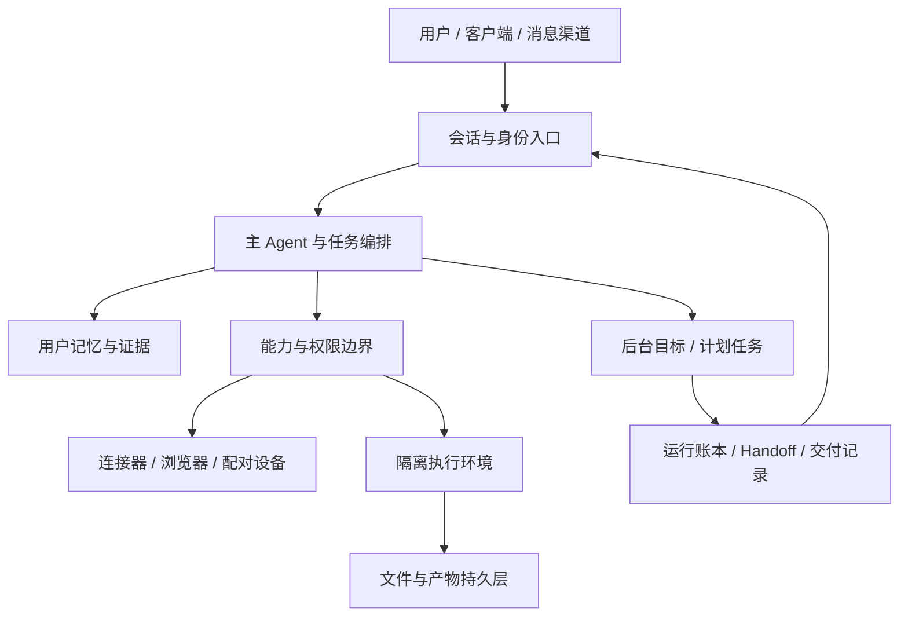

# Muse 与 Town：按模块拆解个人 Agent 的实现方案

- 作者 / 发布方：本知识库整理。
- 发布日期：资料各异；Town 观察主要在 2026 年 6–8 月，Muse 资料文件的独立发布日期未知。
- 归档日期：2026-10-23（Asia/Shanghai）。
- 标签：Personal Agent、Harness、长期记忆、主动性、后台任务、沙箱、凭证隔离、跨渠道、Artifacts、逆向分析。
- 保存形式：综合技术解读与参考实现设计；不保存第三方资料全文。
- 核验范围：综合技术分析；未运行两款产品、未访问其生产系统、未审计完整服务端源码。历史观察与文档描述不等于生产实现已获独立验证。

## 一句话摘要

Muse 资料呈现“持久用户计算机 + 可追溯记忆 + 后台工作与交付账本”；Town 的现有材料呈现“连接工作上下文 + 临时受限沙箱 + 显式数据导入导出 + 渐进自治”。两者相似的产品能力，并不意味着底层状态、执行和权限模型相同。

## 0. 阅读约定、对象与证据等级

### 0.1 本文所说的 Muse

主体是 **Muse 个人 Agent**。以下同名内容不混入主体结论：

| 名称 | 实际对象 | 本文处理 |
| --- | --- | --- |
| Muse Spark / Wonder | 模型或评测配置 | 不能证明个人 Agent 的内部架构，不据此推断 |
| Meta Muse Code | 编程 Agent 相关分享 | event log 等线索不直接嫁接到个人 Agent |
| MUSE-Autoskill | 技能自进化研究 | 是不同研究对象，不等于 Muse 的 skill review 实现 |
| OpenMuse / nanoMuse | 独立开源项目 | 属于其他项目，不把其 SQL leases、relay 或设备能力当 Muse 事实 |
| Town | town.com 的 Townie 助手 | 与 a16z AI Town、Gas Town 等项目区分 |

### 0.2 每条结论的等级

- **[D] 文档直接描述**：特定版本的文档、schema 或 README 确实这样写。它证明“资料这样描述”，不证明生产服务按此运行。
- **[O] 历史观察**：历史样本中的沙箱命令结果、调用轨迹或产品行为。本次未重新实测，观察只对当时样本负责。
- **[I] 工程推断**：由数据结构与行为解释职责边界，但没有执行代码或生产证据。
- **[R] 参考实现**：为了把材料变成可实现方案而给出的自拟契约、流程或测试。不是逆向发现，也不是两款产品的实际代码。
- **[U] 未知或冲突**：资料未覆盖，或同一资料中的描述相互矛盾。

下文的字段若来自资料，会标出原表或文件；自拟的数据结构集中标为 [R]。不能把“schema 有这个字段”升级成“知道了所有状态转换、事务边界和恢复算法”。

### 0.3 分析范围

本文聚焦产品机制与工程职责，不包含服务端完整源码审计或当前生产环境验证。历史样本只能解释当时的行为；未独立复核的细节保留为观察或推断，不能升级为已确认的产品事实。

## 1. 总体架构：先把四类状态拆开

### 1.1 两款产品的架构投影



这是 **[I] 职责图**，不是服务部署图。不能据此推断有九个微服务。

| 状态 | Muse 材料 | Town 材料 | 应保留的边界 |
| --- | --- | --- | --- |
| 用户知识 | Markdown、claims、检索条目、关系页 [D] | Wiki、邮件建立用户画像 [D/O] | 事实、证据与推断分开 |
| 执行过程 | agents、browser tasks、runs、checkpoint [D] | 可替换 sandbox 与会话连续性 [O/I] | 会话存活不代表某个进程或 VM 存活 |
| 用户文件 | home/workspace 持久，Library 是可见产物入口 [D] | sandbox 本地盘临时，town_cp 拷出 [O] | 工作路径与持久引用分开 |
| 权限与凭证 | Sentinel/authd/独立凭证存储的描述 [D] | 受控代理与宿主工具层 [O/I] | 数据和状态恢复不自动恢复授权 |

### 1.2 已知差异，及不能推出的结论

**Muse [D]**：system prompt 的 Filesystem 段落声称 `~` 跨 VM 重启、替换保留；home 之外的系统目录应视为临时。`workspace` 承载任务文件、可编辑记忆与用户产物。

**Town [O]**：6 月沙箱报告观察到 `/home/user`、`/code` 是实例内可写盘；同一 Session 可能出现新 sandbox。报告不承诺跨实例保留这些路径。

因此不能用“都是 VM”把二者合成一个持久化模型。Muse 的 home 是怎样持久化的——块盘、文件同步、快照还是对象存储恢复——当前资料没有证明。Town 的 `vfs://` 是否有租期、版本与回收机制，也未给出。

## 2. 用户画像冷启动：Town 的 fast/full 双路径

证据口径：Town 调用行为标为 [O]；本文为解释该机制给出的契约与方案均标为 [R]，不能算 Town 的实际实现。

### 2.1 Fast path 的可见调用链

```text
Gmail sent-message search
  -> 消费搜索摘要
  -> 提取少量画像
  -> update_user_md
```

历史文档记录：

| 项目 | 当时观察 |
| --- | --- |
| 工具顺序 | `search_emails` → `update_user_md` |
| 查询 | `in:sent after:<cutoff-date> -"unsubscribe" -"do not reply" -"automated" -"noreply"` |
| 请求数量 | `max_results = 30` |
| 样本命中 | 8 封 |
| 全文读取 | 0 封，只使用 search snippets |
| 排除动作 | fast mode 不用 `read_email`、`web_search` |
| 输出范围 | name、role/company、communication style、2–3 个 likely priorities |
| 不生成 | key contacts |
| 时间 | fast preview 约 13 秒；full update 约 2 分钟 |

这个时间是单次历史观察，不是 p50、p95、SLA 或今天的性能。查询日期以占位符表达，不是已知的永久参数。

### 2.2 为什么 sent mail 是一个合理压缩边界 [I]

用户主动发出的邮件更可能包含自己的角色、决策、项目与表达方式；与全 inbox 相比，它减少营销信息与被动抄送。使用 snippet 进一步减少网络读取、正文解析与上下文体积。

代价是信息不完整：摘要可能截断语气，角色签名可能过期，工作邮箱不能代表全部生活。只应形成低成本的初始假设，不应产生高置信度关系图。

### 2.3 Full path 的职责 [O/I]

文档转述 full update 会读取代表性邮件全文、做 web search。它与 fast path 的差别不仅是“读得更多”，还在于允许更昂贵的证据补充与画像修正。Town 如何选择代表性邮件、并发几路、用什么模型、何时覆盖旧画像，均未知。

### 2.4 可实现的契约 [R]

```ts
type ProfilePreview = {
  source: 'sent_mail_snippets';
  observedAt: string;
  messageCount: number;
  facts: Array<{
    field: 'name' | 'roleCompany' | 'communicationStyle' | 'priority';
    value: string;
    confidence: number;
    evidenceMessageIds: string[];
  }>;
  completeness: 'preview';
};
```

实现时应将初始结果标为 preview，让 full enrichment 通过证据替换旧值，保留“没有找到”与“明确不存在”的区别。可验证场景包括零封命中、搜索超时、摘要中出现指令、过期公司签名、多账号、用户在 full 更新前纠正画像。

## 3. 长期记忆：Muse 的文件、Claim 与索引三层

证据口径：相关文档描述或历史观察；未获生产实现的独立验证。

### 3.1 文件分工

| 文件 / 目录 | 资料中的职责 |
| --- | --- |
| `MEMORY.md` | 精简的长期 Facts、Preferences、Commitments，不做逐字转录 |
| `memory/<date>.md` | 按日期保留更完整的日常记录与变化轨迹 |
| `memory/people/`、`memory/groups/` | 每个人或群体的关系页，各有 INDEX.md |
| `memory/bank/`、`memory/index/` | runtime 管理的记忆区域；Agent 可读，不直接编辑 |
| `USER.md` | 用户相关基础材料 |
| `AGENTS.md` | 工作方法与耐久经验，不是用户事实库 |
| `SOUL.md` | 身份与行为风格材料，不等于用户偏好 |
| `dreams/` | 日期化反思及关系修复线索 |

注意：后三个文件的边界来自 workspace manual/system prompt，不等于文件内容永远自动加载。未得到完整 prompt 装配代码。

### 3.2 Claim 层的实际字段

资料 schema 描述 `memory.claims`：

| 字段组 | 字段 | 语义 |
| --- | --- | --- |
| 身份 | `claim_id`, `run_id` | 可引用的事实与生成关联 |
| 内容 | `kind`, `salience`, `claim_text`, `speaker`, `quote` | 事实类型、显著性、内容与来源说话人 |
| 证据 | `evidence_handles`, `source_path`, `source_line` | 回溯到证据和文件位置 |
| 替代 | `supersedes_claim_id` | 表达新事实对旧事实的替代 |
| 生效 | `status`, `confidence`, `first_seen`, `reinforced_at`, `valid_until` | 有效性、置信度与时效 |

这比“把用户信息写 Markdown”更具体：同一条事实具有证据、替代关系和有效期。`supersedes_claim_id` 在资料中是 opaque reference，不能宣称它一定有数据库外键约束。

### 3.3 检索投影与向量层

`memory.entries` 记录 `memory_uri`、`chunk_id`、`source_type`、`status`、`privacy_class`、`confidence`、`citation_path`、行号范围、标题、正文与 `reason_text`。

`memory.embeddings` 通过 `memory_entry_id` 关联 entries，通过 `embedding_model_id` 关联模型目录；样本类型为 `vector(384)`，并对 entry/model 组合唯一。

**能确认的**：schema 描述了文件定位、条目投影与向量存储。

**不能确认的**：embedding 模型是哪一个、是否同时 BM25、向量距离、ANN 索引、reranker、召回配额、chunk 长度、查询融合权重及生产维度是否一致。`vector(384)` 不是识别特定模型的充分证据。

### 3.4 读写闭环

system prompt 描述 `muse.memory_search`、`muse.memory_get` 和 `muse.memory_explain`。对用户历史、决策、关系、偏好与建议，应先检索；被问到来源时，从 explain 恢复证据与替代链。

```text
对话 / 文件变化
  -> 可读记录与长期摘要
  -> Claim + 证据 + 替代关系
  -> 检索条目 / embedding 投影
  -> 行动前搜索
  -> 需要时解释“从哪里知道、哪条取代哪条”
```

箭头顺序是 [I] 解释，不是已知事务调用顺序。文件与 PG 谁是唯一真相、什么时候异步刷新、失败时怎样补偿，仍未知。

### 3.5 冲突、更新与防污染 [R]

参考实现应把事实生命周期建模为：新增 → 活跃 → 被取代/撤回/过期。具体枚举是设计建议，不引用为 Muse 的真实 status 值。

- 同一用户纠正公司信息：新 claim 保留 evidence，旧 claim 被替代，而不是两条平铺返回。
- 一次工具失败：记为发生过的事件，不能直接变成“永远不能使用这个工具”的用户偏好。
- Agent 建议：speaker 必须与用户陈述区分，不能在整理中变成用户已经决定。
- 动作已排队：不能写成已完成；工具成功也不自动代表最终送达。
- 对过期计划保留事件历史，但不继续作为当前承诺召回。

## 4. 遗忘：撤回派生知识，阻止再次写回

证据口径：相关文档描述或历史观察；未获生产实现的独立验证。

### 4.1 两阶段流程

1. `forget.plan({})` 启动只读规划任务，从当前对话解析遗忘对象。
2. 检查记忆文件、搜索结果、摘要、偏好、目标、提醒、运行中/计划中的任务及已发布副本。
3. 向用户说明清理范围、不可逆项与边界，等待确认。
4. `forget.confirm({})` 启动新的执行任务，从继承对话读取计划与确认，并重查当前状态。
5. 先停止会把信息重新写回的活动，再使用各模块自己的操作清理输出。
6. 执行器记录需要撤回的 claim IDs 与引用位置。
7. runtime 撤回关联 claim、刷新检索；刷新未完成就不能宣称遗忘完成。

### 4.2 撤回交接载荷

资料描述写入 `workspace/memory/forget/pending.json`，包含 `claims`、`citations` 两个数组。只写 ID 与如 `MEMORY.md#L<n>` 的位置，不再次复制被遗忘正文。

这个交接文件说明遗忘横跨两个执行域：Agent 负责定位与内容清理，runtime 负责派生索引撤回。不能仅删掉 Markdown 一行就宣布全系统已经忘记。

### 4.3 仍未知的部分

未确认并发写入的 fencing、claim 撤回是否覆盖所有缓存、备份到期、外部发布副本撤回策略。原文也不承诺替用户删除其他人的副本或外部服务记录。

### 4.4 参考验收 [R]

同义句残留、关系页残留、检索旧结果、正在跑的整理任务写回、定时提醒重建、部分删除后刷新失败，都应单独验证。若无法停止未来写回源，结果只能是部分清理。

## 5. 后台自我改进：多个有状态目标，不是一个大 cron

证据口径：相关文档描述或历史观察；未获生产实现的独立验证。

### 5.1 资料列出的后台工作

| 工作 | 文档描述的节奏 | 输入 / 输出 |
| --- | --- | --- |
| Memory upkeep | 有新信号时每小时 | 对话 → MEMORY.md，保留日期记录 |
| Relationships | 每小时 | 用户关系上下文 → people/groups 页面 |
| Idea curation | 每日 | 真实上下文 → 对可行性、契合度、新颖性评分的建议 |
| Studying | 每日、夜间 | 目标 → 研究简报、推进提示 |
| Dreaming | 每晚 | 近期互动 → 反思、关系修复与行为综合 |
| Skill review | 每日 | 工作轨迹 → 新技能、审核与退役 |
| Quiet-moment pass | 重要对话安静后，少量次数 | 一次有界的近期内容整理 |

频率是该资料的描述，不是对所有账号或当前生产版本的承诺。后台调度不由主 Agent 自己随意再次创建。

### 5.2 从 schema 看工作控制

| 表 | 可见结构 | 能说明什么 |
| --- | --- | --- |
| `self_improvement.objective_state` | objective_id、current_file_hash、projection_hash、status、last_run_utc、state_json | 目标有持久进度和文件/投影版本线索 |
| `self_improvement.runs` | run_id、objective_id、request_id、phase/subphase、diagnostics、available_at、run_clock | 单次执行和逻辑目标分开，带排队与阶段信息 |
| `self_improvement.leases` | lease_key、owner、expires_at、heartbeat_at、run_id | 存在带续期信息的工作占有记录 |
| `self_improvement.objective_markers` | objective_id + marker | 有按目标设置的阶段标记 |
| `self_improvement.handoff_dedupe` | objective_id + content_hash、run_id、emitted_at | 有基于内容的交接去重 |
| `self_improvement.learning_adoption_events` | learning_id、run_id、outcome、detail | 有学习项采用结果记录 |

**[I]** 这些结构支持“有边界、有进度、有去重的后台目标”，不是纯粹无状态定时 prompt。还不能推出 lease 抢占算法、hash 的具体计算范围、exactly-once 或恢复事务。

### 5.3 计算证据与校准记录

`calculation_records` 包含 config_hash、code_version、source_handles、normalized_inputs、formulas、outputs；`calibration_records` 包含 change_id、classification、window_start/end、source_handles、diagnostics。

其工程含义 [I] 是把“为什么这样算”和“之后效果如何”拆开保存，支持回放计算与观察结果。没有读到数值打分公式、技能淘汰阈值或评测覆盖率，不能补造。

### 5.4 后台结果的两个链路

```text
解释链：建议 -> rationale / source handles -> 相关记录 / 文件
交付链：run -> step / handoff -> mailbox -> message / delivery
```

“建议有充分理由”和“用户收到建议”是两个问题。文档明确要求分别追溯，不能从 handoff emitted 或 run finished 推断消息已经送达。

## 6. 关系建模：人物页、群组页与证据新鲜度

证据口径：相关文档描述或历史观察；未获生产实现的独立验证。

Muse 资料 [D] 描述以人和群体为单位维护关系页，包含事实、历史和关系性质，并按 closeness 组织。Town 的 People 分析目前只有历史行为观察 [O，弱证据]，包括沟通风格、不确定点和引用来源；fast path 明确不生成 key contacts。

### 6.1 可解释关系模型 [R]

```text
Person identity
  -> 账号/邮箱等可核对标识
  -> interaction evidence（事件时间、来源、参与者）
  -> relationship claims（同事/合作/亲近程度等，附置信度）
  -> 当前关系摘要 + 历史变化
```

不要把“频繁邮件”直接当亲密关系；不把联系人同名直接合并；明确区分用户说的关系、行为证据和 Agent 推断。

### 6.2 应保留的查询边界

人物检索、关系页读取和近期互动读取可分步进行，防止把整本通讯录或所有历史一次塞入 prompt。此处没有证据证明 Muse 使用图数据库，也没有证明 Town 的 People 是知识图谱；“关系图”首先是产品/信息组织概念。

## 7. 主动性产品：Goals、Ideas、Feed、Heartbeat 各管什么

证据口径：相关文档描述或历史观察；未获生产实现的独立验证。

| 模块 | 核心对象 | 触发 | 结果 |
| --- | --- | --- | --- |
| Goals | 用户长期里程碑 | 用户互动、系统研究、独立计划任务 | 进展条目、子目标、简报 |
| Ideas | 建议候选 | 每日后台整理等 | 可选择执行的卡片 |
| Feed | 为个人创作的内容单元 | 系统节奏、brief 变化、手动生成 | 安静进入 Feed 的文章/卡片 |
| Heartbeat | 周期性检查清单 | runtime tick | 检查与必要交接 |
| Proactive preferences | 通知主题、禁忌、时间、格式 | 发送前读取 | 约束主动消息 |

### 7.1 Goals

资料说明 goal 只有 active/completed，没有 pause 状态；需要休息可以关闭主动推送、写进展或完成后重开。子目标只嵌套一层。Goal 本身不自动执行，真实后台工作需要 scheduled job。

schema 的 `goals.goals` 还出现 `pushable`、`parent_goal_id`、`monitoring_signal`、`review_cadence`、`next_review_question`、`implementation_intentions`、`provenance` 等字段。这证明资料中的目标对象比标题+描述更丰富，但不证明所有字段都由 UI 暴露或每个目标都会填写。

简报在 `goals.briefings` 中以 goal_id 和 path 关联；文档明确是系统后台生成，不能承诺任意时刻立即得到一篇现成简报。

### 7.2 Ideas

Ideas 以用户上下文产生可实施建议。文档说约两周或到 expiry 后退场；具体过期时间以记录为准。

schema 描述 `ideas.ideas` 的 rationale、domain、dedup_key、expires_at、generator、prerequisite_notes、embedding；`idea_anchors` 分离展示、生命周期和 build_status，记录 impression_count 与 dismiss_reason。

存在 `ideas.bandit_arm_state` 等表，包含 domain/lane、观测与奖励统计。**[U]** 不能据表名确定线上使用 Thompson Sampling、UCB 或某种具体排序算法；更不能把 Ideas 的 bandit 线索套用到 Feed。

### 7.3 Feed

资料说 Feed 是新创作内容，不是 RSS 聚合转发。输入可以来自 web、连接服务、profile/memory、brief 与过去文章；taste summary 从用户明确反应、讨论和近期主聊天中形成。writer 自身不直接读完整聊天，side chat 不在该 taste summary 的描述范围。

新用户有随产品构建发布的固定引导内容，不能给它编造“读过你的邮件”的来源。brief 真正变化会启动新生成，重复保存不触发；历史文章不因此重写。新文章默认安静进入 Feed，不等于推送通知。

### 7.4 Heartbeat 与通知偏好

`HEARTBEAT.md` 是检查清单；资料另有 `heartbeat__interval@30m.md`。它只是样本文件，不能推断所有工作都由一个 30 分钟心跳执行。

`PROACTIVE_PREFERENCES.md` 的模板包含“想听什么、不要提什么、何时、什么格式”，示例窗口为本地 09:00–21:30。这是样本默认文字，不是全球固定推送时间。

## 8. 计划任务与监控：定义、执行、交付必须分账

证据口径：相关文档描述或历史观察；未获生产实现的独立验证。

### 8.1 三层持久记录 [D]

| 层 | 相关表 | 关键字段 |
| --- | --- | --- |
| 定义 / 调度 | `scheduler.jobs` | schedule_kind、schedule_expr、timezone、enabled、next_run_at、blocked_reason/dependency、next_blocked_probe_at_utc |
| 一次运行 | `scheduler.job_runs` | scheduled_for、trigger_reason、attempt、status、worker_phase、worker_boot_generation、approval_wait、pending_terminal_result |
| 对外交付 | `scheduler.delivery_outbox` | delivery_key、state、attempt_count、next_attempt_at_utc、delivered_at_utc、last_error |

job_id 稳定用于更新；运行历史才说明某次是否执行。schedule 存在并不能证明任务已经跑过，更不证明送达。

### 8.2 阻塞与恢复

文档描述的常见阻塞包括连接器需重新认证、设备离线、浏览器占用、站点验证、需要用户动作。文档同时说“任务暂停自己”以及“稍后计划时间重试”，因此不宜把所有 blocked 都映射为永久 disabled。schema 的 blocked probe 时间支持单独描述阻塞探测。

用户解决连接问题不等于立即自动开跑；需要时使用明确的 run 操作。真实数据库枚举和重试退避公式未完整核验。

### 8.3 轮询与 Hook 的冲突 [U]

文档说“监控与 event-based automations 都由轮询完成”，检测可能有分钟级偏差；同版本 system prompt 却把 hooks 描述为事件到来时即刻触发的脚本。

不能静默选一条当真。可能是文档版本不齐、不同机制或用户可见能力不一致；没有调度代码与真实事件轨迹，不能确认。复刻时应显式区分：

- [R] polling：固定间隔读取源，比较 checkpoint，处理后推进 watermark。
- [R] webhook/event subscription：源端推送，验签、去重并持久化事件再启动执行。
- [R] internal signal hook：处理内部已入账信号，不代表连接器有实时外部流。

### 8.4 通知与外发动作

文档把“通知本人：聊天消息+push”和“用用户账号给第三方发信”分开；后者走连接器权限。监控可发现事件，但不能凭监控能力阻止扣款、拒绝会议或撤回消息。

## 9. 会话、多 Agent 与恢复：上下文不是授权

证据口径：相关文档描述或历史观察；未获生产实现的独立验证。

### 9.1 上下文持续性

Muse 文档区分主聊天、side chats、后台 handoff、设备信号。Compaction 只管理模型上下文，不替代长期记忆或原始消息查证。上下文摘要丢失细节后，要通过记忆、文件和允许的聊天历史读回。

schema 的 `agent.compactions` 有 checkpoint_context_item_id、replacement_history_first/last_seq、summary_text；`runtime_restart_checkpoints` 有 mode、payload_json、execution_config_json、recovery_class/owner_id。

这些字段支持“压缩覆盖某段历史”和“运行重启检查点”的解释，但并未证明具体 summarizer 模型、压缩阈值、prompt cache 策略或原子落盘协议。

### 9.2 子任务与结果回流

system prompt 描述 subagent 继承 transcript，runtime 自动交付结果；协调层再分派时有深度限制。此为资料中的调度规则，不是本文执行指令。

`agent.message_mailbox` 暴露 submission_id、agent_id、conversation_epoch、accepted_ordinal、routing_scope、state、attached_at、terminalized_at、transcript_event_seq；唯一键包含 agent、epoch、ordinal。

**[I]** mailbox 将“结果已接收”和“结果已附入某条对话”分开，epoch/顺序字段可帮助避免旧结果进入错误会话。不能从唯一键宣称消息端到端 exactly-once。

### 9.3 恢复所有权

`agent.recovery_owners` 有 recovery_class、owner_id、generation、agent_id、active_at、terminal_at、terminal_status；与 checkpoint 中的 owner 引用形成恢复归属线索。

参考实现 [R] 应使用 generation/fencing，拒绝旧 worker 在恢复后提交新结果；对不可逆外部动作先查执行凭证，结果不确定时进入人工或查询核对，不盲目再发。

## 10. 渠道路由：同一助手，回复仍有明确归属

证据口径：相关文档描述或历史观察；未获生产实现的独立验证。

Muse 的 chat-connections 文档 [D] 把消息服务当 side chat 的传输层：每个对话有 chat UUID，transport 不创建第二份独立 transcript，也不能替另一聊天选择收件人。

入口 runtime 在执行前捕获 chat UUID 和 binding authority；创建在某渠道 side chat 的定时任务，默认回到该聊天。重连不能把已排队的旧任务自动送给新绑定账号。

schema 的 `chat.message_bindings` 记录 provider、native_conversation_id、native_message_id、chat_id、binding_epoch、admitted_at；这些是防串线的关键关联信息。

### 10.1 渠道、连接器、设备能力是三件事

| 需求 | 类型 | 不能误认为 |
| --- | --- | --- |
| 在 WhatsApp 给助手发消息 | 渠道 | 授权读取用户所有 WhatsApp 聊天 |
| 用 Gmail 搜索邮件 | 连接器 | 已允许发送邮件 |
| 在配对 Mac 搜本机 WhatsApp 库 | 设备能力 | 云端 WhatsApp connector 或发送能力 |

Town 的历史 changelog 有 Web、Slack、邮件、WhatsApp、Telegram、iOS、macOS 的功能与修复记录 [D，二手汇总]；这证明存在多入口产品需求，不证明它采用 Muse 的 chat UUID 或 binding_epoch 设计。

### 10.2 参考入站信封 [R]

```ts
type AdmittedMessage = {
  userId: string;
  chatId: string;
  provider: string;
  externalConversationId: string;
  externalMessageId: string;
  bindingRevision: string;
  admittedAt: string;
};
```

回复、异步交付、审批与附件应继承受信的入口绑定；模型生成的文字不能决定最终 transport recipient。重试去重至少同时考虑 provider 和 externalMessageId。

## 11. Connector 与 Skill：能力目录和凭证边界分离

证据口径：相关文档描述或历史观察；未获生产实现的独立验证。

### 11.1 Connector 的四个维度

1. **能力存在**：skill 是否文档化该命令。
2. **连接存在**：当前账号是否 connected。
3. **供应商授权**：OAuth grant 是否覆盖需要的 scope。
4. **产品动作权限**：该方法是 Allow、Ask 还是 Deny。

文档强调 method default 优先于 action-group default。默认值不等于用户当前设置，已连接不代表所有动作允许；scope 错误也不意味着重新连接一定解决。

限流有 `connector_rate_limited`、`retry_after_seconds`；带 `terminal_for_attempt` 的限制终止当前尝试。这里是资料中的限制契约，不能用模型循环、子任务或替代调用偷偷绕过。

### 11.2 自定义 Connector 的实现入口

skill-creator 文档 [D] 描述：先通过 `credentials.request_api_access` 处理 provider 准入和安全接入，再 scaffold connector skill。生成器从 authd 读取 connector 元数据，为 skill 生成 Tooling/Auth 部分，包含 helper、凭证放置方式、允许 host 和失效替换流程。

设计价值 [I]：模型负责编排业务步骤，auth helper 负责真实注入，避免把 token 拼进 shell、文件或 prompt。401/403 也可能是 helper 根本没有附加认证，不能直接判断 key 无效。

### 11.3 Skill 的组织与演化

```text
SKILL.md：触发条件、核心流程、输出与边界
references/：较长说明，按需加载
bin/：协议与执行细节
assets/：实际使用的模板或资源
```

技能创建与每日 skill review 结合，形成“发现重复流程 → 固化 → 根据近期结果审核 → 无效时退役”。没有公开证据证明统一评分函数、线上 AB 或自动改代码的完整策略。

### 11.4 Town 的证据边界

Town 产品演进汇总记载 Routines/Skills、公共库、团队安装与权限；历史样本提及约 40 个连接器。这些是历史产品线索，不能推出它的工具 schema、动态检索策略、auth broker 或现在的 connector 数量。

## 12. 凭证、审批与支付：把模型从秘密和授权判断中移开

证据口径：相关安全机制仅按文档描述解读，不作为权威架构或生产部署证明。

### 12.1 三个独立职责

| 职责 | 材料中的机制 |
| --- | --- |
| 执行计划 | Agent / 浏览器任务生成并推进操作 |
| 秘密保管 | authd、Secure Vault，模型只接触 opaque reference |
| 是否可执行 | 独立审批与范围化 permission；schema 明确 Sentinel approval store 不在 muse.db 读面中 |

这里可说明凭证与审批分离，但 Sentinel 内部模型、规则引擎、网络拦截点及部署位置并未被当前阅读的资料代码独立证明。不能仅凭营销文案画成已经确认的安全拓扑。

### 12.2 验证码的受保护路径 [D]

当前请求的站点确认已发送验证码 → 只读对应站点/账号/近期挑战的受保护消息 → 返回 `[credential:<uuid>]` → authd 短期持有真实值 → 浏览器 `credential_fill` 在新的一次性审批后直接注入 → 消费引用。

资料说暂存约十分钟。读取来源许可与向网页填码许可是不同边界，失效或拒绝后不能改成提取原文。此机制描述的是受保护来源路径；不等于任何验证码都自动可读。

### 12.3 持久授权的范围

资料描述可按网站、连接器方法、账号+单一收件人、单个 scheduled task/artifact 等范围授权。购买不接受永久 always-allow；浏览允许也不能替代消费审批。

### 12.4 支付执行链

```text
确认商品与最终价格
  -> 确认钱包已接入
  -> 对精确 merchant / amount / payment selection 审批
  -> Shop Pay 一次性 token 或 Stripe Link 一次性虚拟卡
  -> 原浏览器任务继续 checkout
  -> 核对订单结果与凭证
```

`runtime.checkout_spend_operations` 有 operation_id、client_task_key、checkout_request_id、wallet_request_id、approval_id、state、expires_at_ms、recovery_epoch、wallet_provider；checkpoints 表有 provider、checkpoint_key、external_id、claimed_at_ms、bound_at_ms。

**[I]** 这些字段可关联一次业务操作、审批与外部提交 checkpoint，帮助识别“可能已扣款但回执丢失”。它们不证明外部支付 exactly-once，也不证明商家订单与本地记录总能原子提交。

### 12.5 失败时的正确边界 [R]

提交超时后，先查同一 operation 的结果及商家订单；如果仍未知，保留 unknown 状态并请求核对。不能重新起浏览器任务再次买。资料也描述浏览器等待用户回答时应继续原任务，避免第二个 parked task 重复购买。

## 13. Town 沙箱：外层 MicroVM 与内层进程约束

证据口径：相关文档描述或历史观察；未获生产实现的独立验证。

### 13.1 观察与机制的对应

| 信号 | 报告描述 | 支持的解释 / 局限 |
| --- | --- | --- |
| E2B 环境标记 | E2B_SANDBOX、SANDBOX_ID、TEMPLATE_ID | 支持 E2B 环境判断，单个变量不独立证明虚拟化实现 |
| 虚拟块盘与 hypervisor | vda ext4、CPU 标志 | 与报告的 Firecracker microVM 解释一致 |
| PID 1 | bwrap | VM 内存在 bubblewrap 进程隔离 |
| Capabilities | 全 0 | 该观察进程未保留 Linux capabilities |
| Seccomp | mode 2、一条 filter | 已启用 filter；不证明阻断哪些具体 syscall |
| namespace | net/pid/user 隔离描述 | 为进程隔离提供机制线索 |
| runtime | 报告识别 @anthropic-ai/sandbox-runtime | 原报告结论，未核验锁定版本与启动源码 |

两层职责不同：外层 VM 隔离 guest 与宿主；内层减少 guest 中不可信代码的文件、进程、网络能力。不能把有 microVM 当作无需内层约束，也不能把 bwrap 当硬件虚拟化。

### 13.2 路径与资源

| 路径 | 观察读写 | 生命周期与风险 |
| --- | --- | --- |
| `/home/user` | 可写 | 当前实例工作目录；不能假设跨实例保留 |
| `/code` | 可写 | 当前实例脚本/项目目录 |
| `/tmp` | tmpfs | 消耗内存，适合小文件 |
| `/var/tmp` | 磁盘可写 | 可放较大临时文件，仍不是持久后端 |
| `/usr`、`/etc`、`/opt` 等 | 只读或遮蔽描述 | 限制系统修改，具体以 mount 观察为准 |

报告中的约 1.9Gi 内存、约 996M tmpfs、22.8G 根盘是一个样本的配置，不能当产品规格。tmpfs 与进程争内存，大文件可能引发 OOM；写磁盘只是减少内存压力，并不获得持久性。

### 13.3 Session 与执行实例

User、Session、Sandbox、MicroVM 应区分。报告观察同一 Session 出现 `isNewSandbox:true` 和 socket 标识变化，支持执行实例可替换；“任意跨 Session 都绝不复用 microVM”包含报告推断，不能当作全平台验证结果。

具体 idle timeout、迁移策略、warm pool、VM 快照复用与强制回收宽限期均未确认。

## 14. Town 网络：受控代理，不能把 403 当物理断网

证据口径：相关文档描述或历史观察；未获生产实现的独立验证。

报告观察受限进程只有 loopback、没有默认路由；HTTP 代理在 `127.0.0.1:3128`，SOCKS5 在 `127.0.0.1:1080`，经 unix socket 桥接代理；向 example.com 的 CONNECT 返回 403。

### 14.1 正确解读

- [O] 当前视角无法用普通外网接口直连。
- [I] 经 broker 的策略化网络仍可能可用。
- [U] 一次拒绝不能证明所有域名都拒绝，也不能知道 allowlist 内容。
- [U] seccomp mode 2 本身不能证明 unix socket 的全部规则；报告中的 unix-block.bpf 是额外线索。
- [U] loopback-only 可能来自内层 network namespace，不能直接说整个外层 VM 完全没有网卡。

### 14.2 参考分层 [R]

```text
不可信执行进程
  -> namespace / syscall 约束
  -> 本地代理入口
  -> 目标与动作策略
  -> 审批（需要时）
  -> 外部连接
```

HTTP、HTTPS CONNECT、原始 TCP、DNS、重定向和私网应分别定义策略。代理可达不等于允许任意数据外传；需要请求目标、动作、来源文件与凭证使用共同受控。本文未验证 Town 的代理是否做请求体级 DLP 或 TLS 解密。

## 15. Town 文件：town_cp 与 URI 数据闸门

证据口径：相关文档描述或历史观察；未获生产实现的独立验证。

### 15.1 明确拷贝的职责

报告描述 `town_cp` 是文件移动的显式入口，既能导入 sandbox，也能把结果拷出。没有共享目录透明同步，不会因为程序执行结束自动上传产物。调用被描述为同步阻塞。

| URI | 报告中的语义 | 仍未知 |
| --- | --- | --- |
| `sandbox://` | 当前实例内临时文件 | 句柄如何绑定实例、失效错误是什么 |
| `content://` | 长期保存/分享用途后端 | TTL、版本、ACL、删除与配额 |
| `vfs://` | 会话级后端 | “会话级”精确定义、跨 Session 可用性 |
| `drive://` | 第三方后端 | provider ID/path 映射与回写冲突 |
| `attachment://` | 输入附件 | 缓存与保留策略 |

按 scheme 分发、宿主保管后端凭证、通过 E2B/envd 写入 VM 是原报告的 [I] 机制解释，未见 town_cp 服务端源码。

### 15.2 正确的交付顺序 [R]

```text
输入持久引用
  -> 授权导入临时路径
  -> 在 sandbox 内处理
  -> 校验最终文件
  -> 拷出到持久后端
  -> 获取可核对的持久引用
  -> 将引用写入任务结果
  -> 向用户交付
```

必须在持久化成功后才能把 sandbox 回收视为安全。若拷出超时，应通过目标后端核对是否已创建对象，不能无条件重复覆盖。

### 15.3 任务连续性的参考设计 [R]

```ts
type DurableArtifact = {
  artifactId: string;
  storageUri: string;
  mediaType: string;
  sizeBytes: number;
  sha256: string;
  sourceRunId: string;
  createdAt: string;
};

type TaskCheckpoint = {
  taskId: string;
  revision: number;
  inputs: DurableArtifact[];
  outputs: DurableArtifact[];
  nextStep: string;
};
```

这些字段为本文自拟，不是 town_cp 的真实接口。manifest 描述任务连续性；sandbox ID 只说明当前由哪个可替换实例执行。恢复时重新授权导入，不从旧 checkpoint 恢复账号凭证。

## 16. Muse 文件与 Library：持久目录也是产品 API

证据口径：相关文档描述或历史观察；未获生产实现的独立验证。

Muse 资料 [D] 将上传放在 `workspace/user`，给用户的普通成果放在 `workspace/your_files`；文件存在于工作区不代表自动出现在 Library。浏览器下载落在 Agent 自己的计算机上，不在用户手机里。

### 16.1 目标文档的固定归属

目标相关成果应从第一次写入就进入 `workspace/goals/<slug>/files`；内部 watermark、工作记录放 hidden_files。先生成在别处再拷贝会产生两份漂移文档，移动又可能破坏旧链接。

这是一种 [I] “路径即归属契约”：目录不仅存 bytes，还决定展示、归类和交付。需要限制把中间产物误放入可见目录。

### 16.2 不同类型的删除与分享

文件 trash 的恢复窗口、artifact 永久删除、聊天内鉴权链接、临时公开下载链接、公开 artifact 发布是不同动作。不能把文件链接发出就称为“任何人可访问”，也不能把 pin 当授权或备份。

不同文档对大小、格式转换及端差异有描述；这些参数会随版本变化，本文不把它们写成当前产品限额。

## 17. Muse Artifacts：本地应用与公开运行时的版本分歧

证据口径：相关文档描述或历史观察；未获生产实现的独立验证。

### 17.1 文档描述的产物类型

- Documents：PDF、Word、表格、幻灯片、Markdown 等文件。
- Pages：托管的静态页面。
- Interactive apps：带独立数据状态的应用。

文档声称交互应用在用户环境内以自己的数据库持久化。它同时说只可公开静态快照、交互应用不可公开。下面的 runtime README 却描述了有状态 Cloudflare 发布路径，必须保留分歧。

### 17.2 Runtime README 中的构建链 [D]

```text
workspace/ts-spaces/<slug>
  -> builder subagent
  -> Rust web_artifacts.build
  -> hatch_spaces::build_pipeline::build_space
  -> 本地 Bun 运行时 / 独立 Cloudflare exporter
```

SDK 为 `@hatch/space-sdk`，包含服务器 action 与客户端 action client。Cloudflare exporter 被明确描述为显式命令，不由普通 build 自动执行。

### 17.3 应用数据库与 blobs

README 把结构化、可查询数据放 `ctx.db`，二进制和较大对象放 `ctx.blobs`；数据库中保存 blob key 与可查询元数据。

本地 blob 索引包含 key、content_type、size_bytes、etag、visibility、时间、object_id。对象路径按 `sha256(key)` 分片，etag 是 bytes 的 SHA-256，两者不能混淆；旧对象的 object_id 为 null，保留旧路径读取兼容。

本地 URL 相对文档基址解析，经 daemon/nginx 的 bearer auth；Cloudflare 路径使用 R2，private blob 有 HMAC token。README 还描述 verified viewer、no-store、CSP sandbox 与 nosniff，避免 blob 中的主动内容获得应用同源权限。

### 17.4 Cloudflare 状态迁移

README 描述首次共享时以 fenced SQLite snapshot 初始化 D1，以 blob snapshot 转移到 R2；control plane 核对 runtime、shortcode、slug，不能用后续本地 seed 覆盖活跃远端库。共享期间 migrations 作用于远端；取消共享先 drain writers，再还原 D1/R2 到本地，之后才启用本地写入。

迁移中保持单一写入归属是 [I] 核心。具体分布式锁与失败回滚算法没有在已读 README 中展开，所引用的 shared-state contract 未纳入本次完整阅读。

### 17.5 编译期能力边界

Cloudflare shim 暴露 D1 兼容的 ctx.db，不暴露 local-only 的 ctx.inference、ctx.agent、ctx.emit；不支持的 action 在类型检查期失败。`SpaceDb` 不暴露 transaction。它是按执行目标裁剪能力，而非只扫描源代码中的危险字符串。

### 17.6 必须保留的冲突 [U]

| 来源 | 描述 |
| --- | --- |
| docs/artifacts.md | 只可公开静态 artifact，交互应用不能公开 |
| ts-runtime README | 交互应用 D1/R2 状态迁移与 Cloudflare action dispatcher |
| spaces schema | cloudflare deploy/status、storage mode、capability manifest、review 等字段 |

这只能证明资料包含多代或不同能力面的设计。不能宣称 D1/R2 方案已向所有 Muse 用户上线，也不能用旧用户文档否认 runtime 代码资料的存在。

## 18. 浏览器、配对设备与家庭网络

证据口径：相关文档描述或历史观察；未获生产实现的独立验证。

### 18.1 云浏览器与本机浏览器

Muse 云浏览器是独立服务端会话，不继承用户电脑 cookies；配对 Mac 的 computer.control 使用用户本机浏览器环境，Chrome 另开窗口但使用同一正常 profile。二者的数据与授权范围不同。

runtime.browser_tasks 记录 browser_session_id、owner_agent_id、root_message_id、status、state_revision、deadline_at、continuation_root_task_id、input_grants_json、outcome_status/reason 等字段。它支持关联长任务、等待用户和继续执行，但不能据此确定底层 Playwright、CDP 或浏览器池实现。

### 18.2 Mac 能力应来自实时目录

资料列举 files、Notes、Messages、Mail、Calendar、Reminders、Contacts、screen、camera 与 computer control 等能力族，强调以当前设备实际 advertise 的命令为准。Mac 没有通用 shell/program runner；不能因为云 VM 有 exec 就推断能在 Mac 执行任意脚本。

本机 app 视图不等于云账号全集。本机 WhatsApp 搜索不等于发送能力。专用数据能力被禁用时，不能改用屏幕操作绕过其权限。

### 18.3 设备同步事件

subscription 文档描述统一 global_seq，以 producer_id 区分设备，以 source 区分流。列表只给 summary_preview；需要时再读单事件 payload，并有 raw/summary/redacted 表示形式。

notification/sms/imessage 新事件描述为脱敏元数据，不保留可直接读的原消息正文。设备事件账本不是 canonical 联系人、日历或健康库；后者有单独查询入口。

### 18.4 Home Link 与 Tailscale

| 通道 | 文档实现 | 能力限制 |
| --- | --- | --- |
| Home Link | 实验性 ESP32-C5 Wi-Fi 桥，BLE 初始设置；本地 discovery；代理 3129 | 发现可用 UDP/multicast，控制请求主要走 HTTP/CONNECT TCP；不是云浏览器可直接打开的家庭网页 |
| Tailscale | VM 作为仅出站客户端加入 tailnet；代理 3130 | TCP 连接，不是任意 IP 包；ping 失败不能证明目标离线 |

Home Link 要用当前发现结果中的地址/端口，并核对官方协议；普通公网授权不等于家庭网络授权。Tailscale 的 enrollment 与访问某个地址又是不同审批；切换目标名称/IP 可能属于另一地址范围。

这些材料把公网、家庭 LAN、tailnet 明确分成不同路由与权限域。不能据代理端口推断它们共用一个进程，也不能把实验文档当作所有账号可用能力。

## 19. Town 功能模块：从 changelog 提取约束，避免编造后端

证据口径：相关文档描述或历史观察；未获生产实现的独立验证。

| 功能模块 | 材料中的能力 | 能合理提炼的工程问题 [I] | 当前未知 |
| --- | --- | --- | --- |
| Docs / Decks | 可编辑文档、幻灯片、导出 Slides/PPTX/PDF | 产物版本、编辑回写、导出一致性 | 协同算法、文档内部格式、渲染栈 |
| Tasks | 工作区、定时、附件、移动端任务 | 长任务状态、附件归属、跨端一致性 | 队列、workflow engine、checkpoint schema |
| Routines / Powers | 邮件/日历/Slack 触发、Webhook、库与分享 | 触发去重、重放、安装版本和运行日志 | trigger 真实传输、幂等键与退避 |
| Team Routines | 安装、权限、团队工具隔离 | owner 与 executor 分离、能力继承范围 | RBAC/ABAC、租户分区与共享存储 |
| 自动排会 | 时区、可选参与者、会议形式、可配置免逐次审批 | 空闲快照、冲突重查、邀请权限 | 冲突算法与事务安排 |
| 邮件工作流 | 草稿、审批、可信地址、独立邮箱、线程修复 | 账号/别名/线程身份、重复发送与信任范围 | 邮件路由和存储模型 |
| 个性化 | Need to Know、Morning Briefing、Town Wiki | 时间窗口、来源、事实新鲜度、主动触达 | Wiki 格式、检索、模型和写入策略 |
| 多渠道 | WhatsApp、Telegram、Slack、邮件、原生端 | 回复归属、附件转换、断线恢复 | transport binding 契约 |
| 商业化 | credits、账单、成本优化 | 计费归属、用量与预算 | 定价、token accounting、实时成本算法 |

Town Wiki 的“每晚维护偏好、目标与项目”仅有概述层面的描述 [D，未独立核验]；缺少该夜间任务的执行轨迹。Town 的 autoscheduling 和信用计费更不能从产品表述推出一个特定数据库或调度器。

## 20. 两者的模块对照与设计取舍

| 模块 | Muse 目前证据较具体之处 | Town 目前证据较具体之处 |
| --- | --- | --- |
| 冷启动 | 记忆导入与聊天提炼契约 | sent snippet → user_md 的少步骤轨迹 |
| 长期记忆 | claims、supersession、证据与 embedding 投影 | Wiki 产品语义，底层存储未知 |
| 关系 | people/groups 页面与后台整理 | People 产品观察；fast 不做联系人 |
| 主动性 | Goals/Ideas/Feed/后台工作分工 | Routines、briefing、自动排会的演进 |
| 持久执行 | runs、leases、mailbox、recovery owner 的 schema | Session 可更换 sandbox 的观察 |
| 沙箱 | home 持久的契约；具体 VM 存储未知 | microVM + bwrap/seccomp 的环境观察 |
| 文件 | 目录归属、Library、目标文档、artifact DB | town_cp 与 URI 显式拷贝边界 |
| 权限 | method、recipient、task、wallet/credential 流程 | 代理拒绝与审批演进线索 |
| 设备 | Mac、同步流、Home Link、tailnet 文档 | 多端产品更新，协议未知 |
| 团队 | 个人实例隔离；文档明确无多用户共用 | 团队 Routines、隔离与共享产品能力 |

### 20.1 可复用的组合方案 [R]

把个人 Agent 分成六个相互独立、可替换的能力层：

1. **证据层**：保存原始记录、出处、时间与主体，不把推断混成事实。
2. **记忆层**：长期摘要、claims、关系页与可重建索引。
3. **执行层**：临时 sandbox、浏览器任务、设备调用，不拥有持久用户真相。
4. **持久工作层**：job 定义、run、checkpoint、lease、outbox；分别记“准备做、做过、送达”。
5. **权限层**：账号/动作/目标/收件人/任务的授权，凭证由 broker 注入。
6. **产品层**：聊天、Goals、Ideas、Feed、Library、团队 Routine，把工作状态变成可理解的用户对象。

这套组合并不要求复制某个厂商的 VM、数据库或模型。最重要的是不要让一段聊天历史、一块 sandbox 磁盘或一个 Markdown 文件同时承担这六类责任。

### 20.2 参考实现的关键不变量

| 不变量 [R] | 必须验证的失败场景 |
| --- | --- |
| 不把摘要当唯一证据 | compaction 丢失原决定后仍能检索出处 |
| 不把文件路径当永久产物 | sandbox 替换后能按 durable reference 找到成果 |
| 不把 run success 当 delivered | 生成成功但 outbox 失败，仍显示待送达 |
| 不把 connected 当 allowed | OAuth 有 scope，但动作权限 Deny 时不能执行 |
| 不把恢复状态当授权 | 旧 checkpoint 不能恢复已撤销的账号权限 |
| 不把遗忘当删一行 | 后台工作和索引不能把被撤回事实写回 |
| 不把任务名当幂等键 | 同名任务的独立 run 不覆盖彼此，重试不重复发送 |
| 不把交互卡片当后台工作 | Goal/Idea 创建后只有显式执行才产生 run |
| 不把部分失败当无副作用 | 邮件/订单回执未知时先查询，不盲目重试 |
| 不把渠道当数据源授权 | 通过 WhatsApp 找助手不授予所有聊天读取权 |

## 21. 未决问题与下一轮最有价值的取证

| 问题 | 已有线索 | 还需要的证据 |
| --- | --- | --- |
| Muse 文件/claims/index 谁是唯一真相 | 三类结构都存在 | 写入实现、失败恢复和重建契约 |
| Muse 检索是否混合召回 | vector(384)、search 工具 | 查询实现、索引配置、rerank 轨迹 |
| Muse 自我改进怎样评测技能 | adoption/calibration、skill review 文档 | 评分器、样本、阈值和回滚记录 |
| Muse 哪些监控实时 | hooks 与 polling 文档冲突 | 各类 trigger 的真实入口和运行轨迹 |
| Muse Artifact 能否公开交互状态 | 产品文档与 D1/R2 README 冲突 | 发布版本、feature availability 和线上示例 |
| Muse Sentinel 的执行边界 | 独立审批存储、permission 描述 | 审批调用链、网络/进程拦截代码与威胁模型 |
| Town home 与 vfs 的寿命 | sandbox 临时、URI 拷贝 | 回收/恢复实测和持久引用契约 |
| Town town_cp 是否保护导出窗口 | 同步拷贝观察 | drain/lease/cancel 语义和大文件测试 |
| Town 跨用户 microVM 复用策略 | 原报告推断不复用 | 调度与清理协议，不靠单次 guest 检查 |
| Town Wiki 如何合并纠正 | 夜间更新摘要 | before/after、来源与撤回轨迹 |
| 两者不可逆动作怎样防重复 | Muse checkpoint/outbox schema；Town 可靠性修复 | 故障注入及供应商侧实际结果核对 |

优先顺序应是补原始调用轨迹、版本与失败语义，再追问模型品牌或 prompt 措辞。当前可见的大多数可靠性差异，来自状态、权限与数据边界，而不只是提示词。

## 附录：核验限制与维护

本文保留技术行为、模块边界、数据结构和参考设计，不披露采集渠道、内部文档位置或资料定位信息。文档描述、历史观察、工程推断和参考实现仍按开头的等级区分，未独立核实的结论不因脱敏而变成已验证事实。

下一次更新应优先核对运行版本、失败语义与可复现实验。遇到冲突先记录，参考实现需要独立测试，不能因采用了相似设计就宣称通过生产验证。

[模块索引](README.md) · [总索引](../../INDEX.md)
